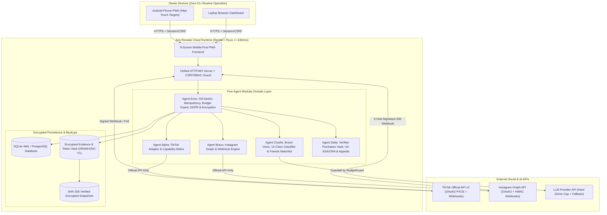
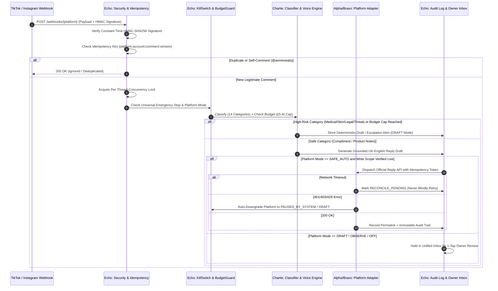
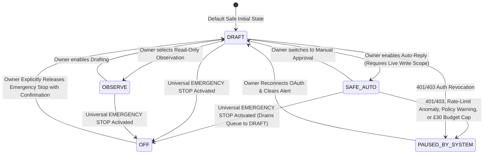
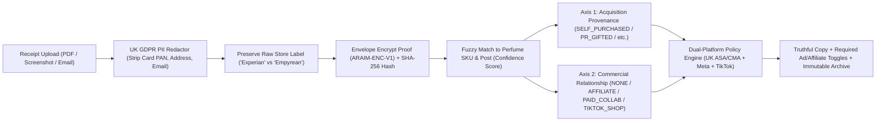

# Ann Reveals AI Manager (v4.0) — Architecture & Component Diagrams

**Author:** Agent Echo (Agent 5 — Principal Platform Architect, Security Engineer & SRE)  
**Version:** 4.0 FINAL  
**Target Ceiling:** ≤ £30.00/month Managed Cloud Modular Monolith + Mobile-First PWA

---

## 1. System Context & Container Architecture (Mermaid Flowchart)

---

## 2. Inbound Comment to Safe Outbound Dispatch Sequence

---

## 3. Universal Kill-Switch & Mode State Machine

---

## 4. Verified Purchases Vault & Dual-Platform Disclosure Pipeline

