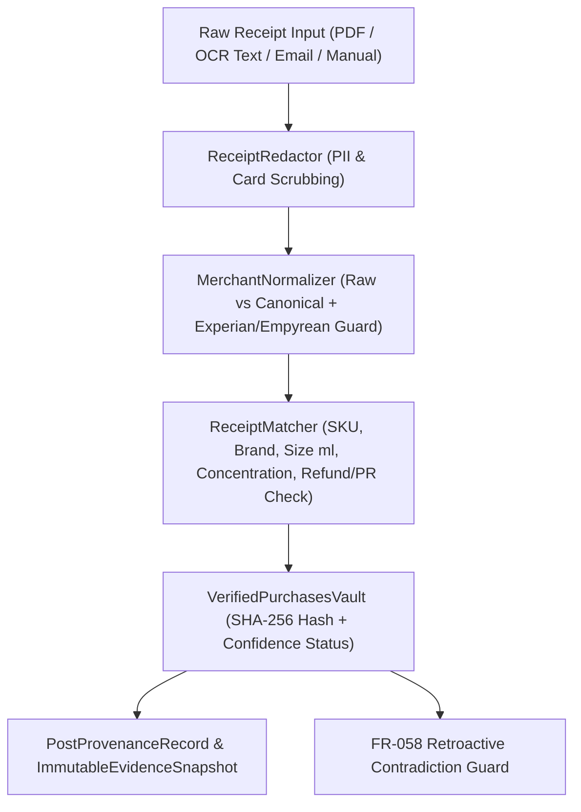

# Provenance Verification, Redaction & Merchant Normalization Rules

**Project:** Ann Reveals AI Manager (`ARAIM` v4.0)
**Owner:** Agent Delta (`content-integrity`)
**Covers:** `FR-018`, `FR-019`, `FR-020`, `FR-021`, `FR-028`, `FR-046`, `FR-051`, `FR-052`, `FR-057`, `FR-058`, `NFR-05`, `NFR-06`

---

## 1. Architecture Overview

---

## 2. PII & Financial Data Redaction Specification (`apps/backend/provenance/redactor.py`)

Before any receipt text is saved to disk, indexed in the Vault, passed to an LLM, or included in an Appeal Packet, `ReceiptRedactor` deterministically masks:

1. **Payment Card Numbers (PAN & Last-4):**
   - 13-to-19 digit sequences (with spaces or hyphens) matching card formats / Luhn check -> `[REDACTED_CARD_PAN]`.
   - Explicit last-4 card notations (e.g., `Visa ending in 4421`, `Mastercard **** 8892`, `Card: •••• 1234`, `Amex x1004`) -> `[REDACTED_CARD_LAST4]`.
2. **Bank Account, UK Sort Code & IBAN:**
   - UK Sort Codes (`12-34-56`) -> `[REDACTED_SORT_CODE]`.
   - IBANs (`GB29 NWBK ...`) -> `[REDACTED_IBAN]`.
3. **Billing & Delivery Street Addresses + UK Postcodes:**
   - UK postcodes (e.g., `SW1X 7XL`, `M1 1AE`, `EC1A 1BB`) -> `[REDACTED_POSTCODE]`.
   - Street lines (`14 Kensington High Street`, `Flat 4B, 22 Baker St`, `Billing Address: ...`, `Ship to: ...`) -> `[REDACTED_ADDRESS]`.
4. **Contact Identifiers:**
   - Email addresses (`ann.personal@example.co.uk`) -> `[REDACTED_EMAIL]` (after extracting a salted/boolean domain/owner match flag for internal Mismatched-Purchaser detection).
   - UK & international phone numbers (`+44 7700 900077`, `07700 900077`) -> `[REDACTED_PHONE]`.
5. **Invoice, Order Barcodes & QR Payloads:**
   - Raw barcode strings, QR payload URIs, and long numeric invoice serials -> `[REDACTED_BARCODE]` / `[REDACTED_ORDER_REF]`.

---

## 3. Raw vs. Canonical Merchant Normalization (`apps/backend/provenance/merchant_normalizer.py`)

### 3.1 The `Experian` vs. `Empyrean` Disambiguation Rule
The owner noted buying fragrances from `"Experian"` or `"Empyrean"`.
- **Hard Constraint:** `experian.com` / `experian.co.uk` is a credit reference agency, **never** a perfume retailer.
- Every record stores:
  - `merchant_label_raw`: Exact string from OCR or user input (e.g. `"Experian"`, `"Empyrean"`, `"Empyrean Parfums"`).
  - `normalized_name`: Canonical retailer name or `"UNVERIFIED_MERCHANT (Raw: Experian)"`.
  - `normalized_domain`: Canonical web domain (or `None` when unverified).
  - `is_ambiguous_experian`: `True` when the raw input contains `"experian"`.
  - `owner_verified`: `True` only when the owner has explicitly confirmed the merchant identity.

| `merchant_label_raw` | `owner_verified` | `normalized_name` | `normalized_domain` | Status / Action |
| :--- | :--- | :--- | :--- | :--- |
| `"Experian"` | `False` | `"UNVERIFIED_MERCHANT"` | `None` | Flag `AMBIGUOUS_MERCHANT_EXPERIAN_EMPYREAN`. Never assign `experian.com`. Require owner confirmation before claiming verified Empyrean purchase. |
| `"Experian"` | `True` (confirmed as Empyrean Parfums) | `"Empyrean Parfums"` | `"empyreanparfums.com"` | Preserves `merchant_label_raw="Experian"` in audit log; unlocks verified self-purchase status. |
| `"Empyrean"` / `"Empyrean Parfums"` | `False` / `True` | `"Empyrean Parfums"` | `"empyreanparfums.com"` | Recognized niche fragrance house. |
| `"Selfridges & Co"` | `False` / `True` | `"Selfridges"` | `"selfridges.com"` | Recognized UK luxury department store. |
| `"Harrods Knightsbridge"` | `False` / `True` | `"Harrods"` | `"harrods.com"` | Recognized UK luxury department store. |

---

## 4. Receipt-to-Perfume Fuzzy Matching & Confidence Scoring (`apps/backend/provenance/matcher.py`)

Each receipt is evaluated against a target `PerfumeItem` (`sku`, `product_name`, `brand`, `variant`, `size_ml`, `concentration`) across weighted criteria:

- **Brand Match:** `+0.25`
- **Product / Fragrance Name Match:** `+0.35`
- **Concentration Match (`EDP`, `EDT`, `Parfum`, `Extrait`, `Cologne`):** `+0.15`
- **Size Match (`size_ml`, e.g., `100ml` vs `50ml`):** `+0.15` (Mismatch deducts `-0.30` and adds `SIZE_MISMATCH` warning)
- **Valid Positive Price Paid (`> 0.00`):** `+0.10`

### Disqualifiers & Status Classification
- **`CONFLICTED`:**
  - Receipt shows `REFUNDED`, `CANCELLED`, or `CHARGEBACK`.
  - Receipt shows `£0.00` price with `PR SAMPLE`, `PRESS GIFT`, `COMPLIMENTARY`, or `100% PROMO` while the post claims `SELF_PURCHASED`.
  - Duplicate order reference already bound to a different claimant or contradicted by a subsequent credit note.
  - Purchaser email/name explicitly belongs to a third party (`purchaser_mismatch=True`) without owner gift/household confirmation.
- **`VERIFIED_SELF_PURCHASE`:**
  - Score `>= 0.85`, net amount paid `> 0`, not refunded, merchant verified (not unconfirmed `"Experian"`), and no conflicts.
- **`UNVERIFIED`:**
  - No receipt uploaded (`confidence = 0.0`), partial/low-confidence OCR match (`< 0.85`), wrong bottle size (`50ml` receipt for a `100ml` bottle shown on camera), or unconfirmed `"Experian"` merchant label.

---

## 5. Retroactive Receipt Contradiction Guard (`FR-058`)

When a post has already been published and locked via an `ImmutableEvidenceSnapshot`, any subsequent receipt update (e.g., a refund notification or re-classified £0 PR invoice) linked to the same `PerfumeItem` or `private_order_ref_hash`:
1. **Never** overwrites or mutates the historical `ImmutableEvidenceSnapshot`.
2. Generates a `RetroactiveContradictionAlert` with severity `HIGH`, identifying the `platform_post_id`, the prior provenance state, and the new conflicting receipt state so the owner can review and update live post disclosures manually.
