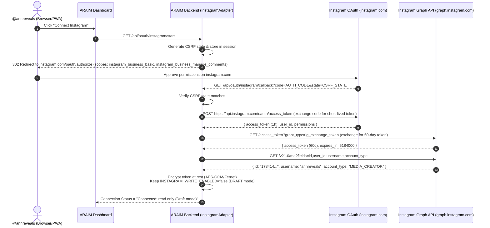
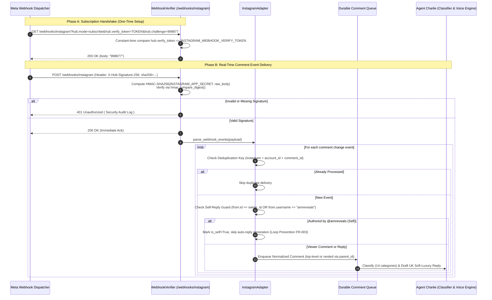
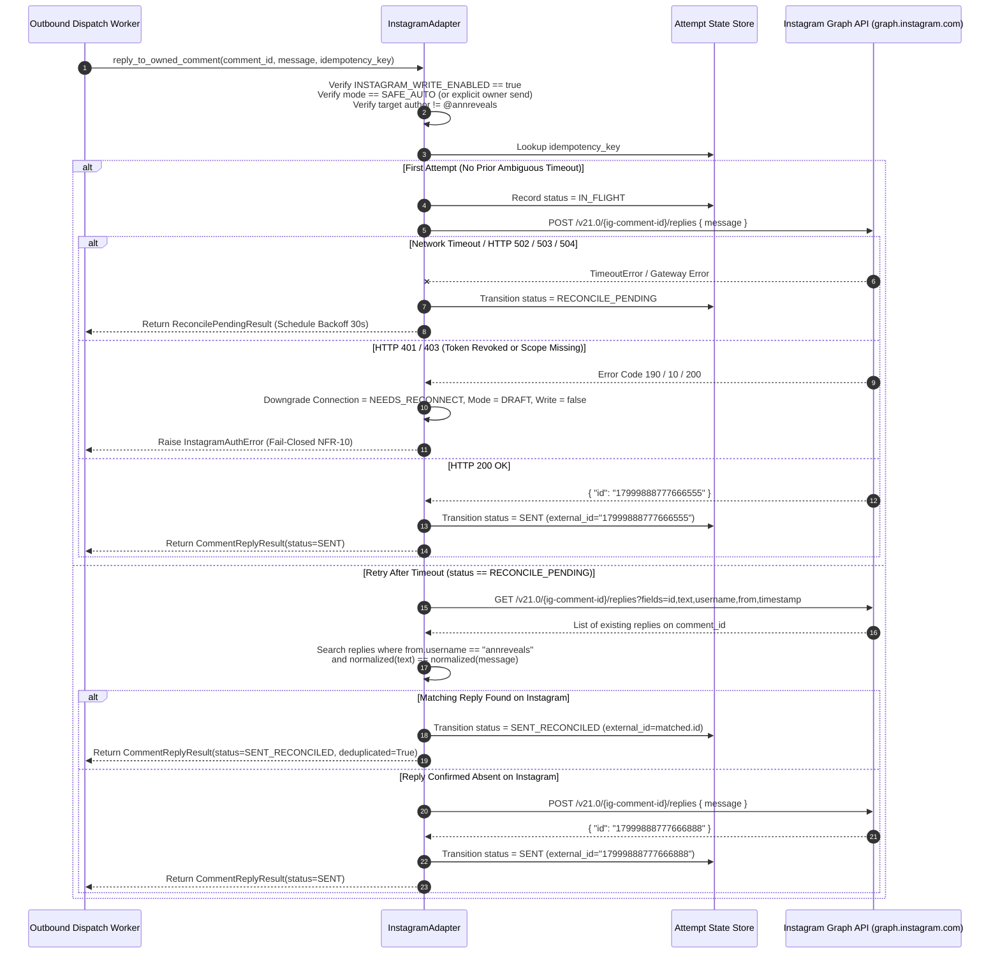

# Instagram Integration — System Sequence Diagrams

**Agent:** Agent Bravo (Agent 2 — Meta/Instagram Developer Platform & Integrations Specialist)  
**Project:** Ann Reveals AI Manager (`ARAIM` v4.0)  
**Last Updated:** 27 October 2026

---

## 1. Instagram OAuth 2.0 Connection & Live Scope Verification

This flow shows how `@annreveals` connects her Instagram Professional (Creator/Business) account via **Instagram API with Instagram Login** without needing a Facebook Page, and how `ARAIM` truthfully sets connection status and keeps `INSTAGRAM_WRITE_ENABLED=false` until pilot verification.

---

## 2. `X-Hub-Signature-256` Webhook Verification, Deduplication & Self-Reply Loop Guard

This flow illustrates how incoming Instagram comment webhooks are cryptographically verified, deduplicated, checked for self-authored comments (`@annreveals`), and threaded before entering the AI classification pipeline.

---

## 3. Safe Auto-Reply Dispatch & Ambiguous Timeout Reconciliation (`RECONCILE_PENDING`)

This diagram shows how `ARAIM` guarantees **effectively-once** comment replies (`NFR-03`) even when Meta's Graph API or the network times out mid-flight, preventing embarrassing duplicate replies under a follower's comment.

