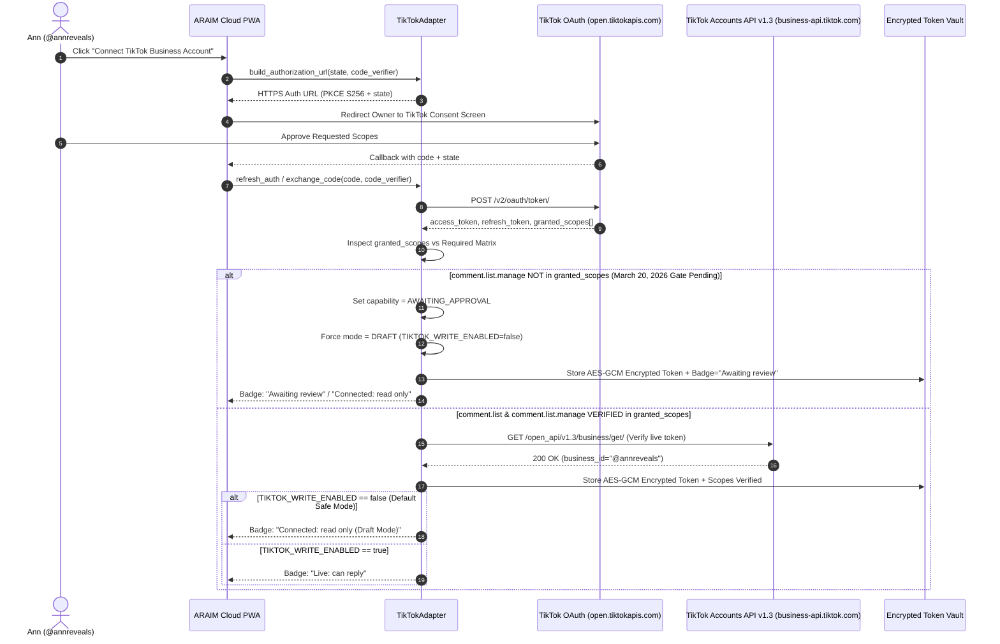
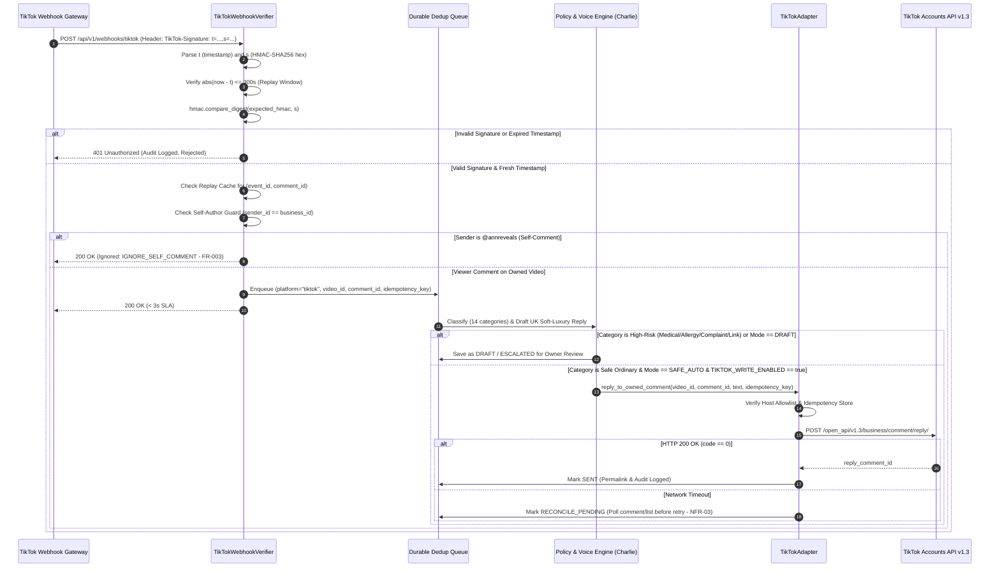
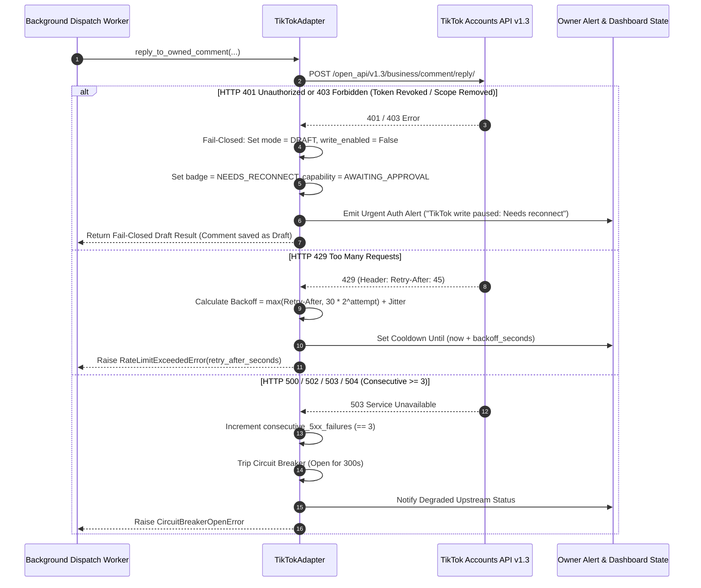

# TikTok Integration Sequence Diagrams (`design/tiktok/sequence-diagrams.md`)

**Author:** Agent Alpha (`Agent 1 — Official TikTok Platform Access, Policy, and Integration Specialist`)  
**Date:** 27 October 2026  
**Project:** Ann Reveals AI Manager (`ARAIM` v4.0)  

---

## 1. OAuth 2.0 PKCE + Live Scope Inspection & Truthful Badge Calculation

This flow illustrates how `@annreveals` connects her TikTok Business Account, how tokens are exchanged and inspected against the **March 20, 2026 TikTok Accounts API v1.3** scopes (`comment.list`, `comment.list.manage`, `video.list`), and how the UI badge is truthfully derived (`FR-038`, `FR-043`, `NFR-05`).

---

## 2. Signed Webhook Ingestion + Self-Loop Guard + Idempotent Owned-Comment Reply

This diagram shows real-time `comment.update` ingestion from TikTok Business Webhook Gateway (`doc_id=1751617884206210`), constant-time HMAC-SHA256 verification, replay defense, self-comment loop filtering (`FR-003`), policy classification (`FR-004`), and idempotent reply dispatch (`NFR-03`, `NFR-04`).

---

## 3. Fail-Closed Downgrade on `401`/`403`, `429` Backoff, and `5xx` Circuit Breaker

This diagram illustrates `NFR-02` and `NFR-10`: automatic downgrade to `DRAFT`/`READ_ONLY` on `401`/`403`, `Retry-After` + jittered `30s/60s/120s` backoff on `429`, and circuit breaker activation after consecutive `5xx` errors.

