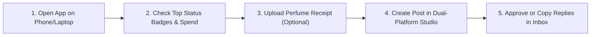

# Ann Reveals AI Manager (`ARAIM` v4.0) — Plain-English Owner Guide & Manual

**Designed for:** Ann (`@annreveals`)  
**How to use:** Everything in this guide works directly from your Android phone or laptop web browser. **You never need to open a terminal or type code.**

---

## Page 1: Two-Minute Quick Start & Daily Routine

### Step 1: Install on Your Android Phone or Laptop (Takes 30 Seconds)
1. Open your unique **Ann Reveals AI Manager** cloud link in Chrome on your Android phone or laptop.
2. Tap **"Add to Home Screen"** (Android) or the **Install App** icon in your laptop address bar.
3. Log in with your Owner Passphrase. You will land on the **Home Dashboard**.

### Step 2: Understand Your Truthful Connection Badges (`FR-043`)
At the top of the Home Screen, you will always see the real, live status of **TikTok** and **Instagram**:
- **`Not connected`** *(Grey)* — Account hasn't been linked yet. Tap **Connect** in the Setup Wizard.
- **`Connected: read only`** *(Blue)* — The app can read your posts and draft replies for you, but cannot post replies automatically.
- **`Awaiting review`** *(Amber)* — Waiting for TikTok or Meta to approve automatic reply permissions. You can still use **1-Tap Copy & Open App**!
- **`Live: can reply`** *(Green)* — Official reply permission is verified and active.
- **`Suspended` / `Needs reconnect`** *(Red)* — Your login expired or the platform paused access. Tap **Reconnect** to fix in 20 seconds.

### Step 3: Choose Your Comfort Mode for Each Platform (`FR-035`)
- **`OFF`**: Completely silent. No comment checks or drafts.
- **`DRAFT` (Recommended Default)**: The app reads comments, filters out spam/trolls, writes warm UK-English reply drafts in your voice, and waits for your **1-Tap Approve** or **1-Tap Copy**.
- **`SAFE_AUTO`**: Automatically replies **only** to safe, ordinary comments (like compliments or fragrance note questions) when official write permission is `Live: can reply`. Sensitive comments (skin reactions, complaints, pricing disputes, collab offers) are **always** held for you personally.

---

## Page 2: Printable 9-Step Setup Checklist & Core Workflows

### Your 9-Step Guided Setup Checklist (`FR-041`)
- [x] **Step 1 — Welcome & Safety Pledge:** Confirm official-API-only protection (zero scraping, zero fake automation).
- [x] **Step 2 — Connect Instagram:** Sign in via official Meta OAuth (reads comments & checks reply permission).
- [x] **Step 3 — Connect TikTok:** Sign in via official TikTok OAuth (if write permission is still `Awaiting review`, 1-Tap Copy mode turns on automatically).
- [x] **Step 4 — Brand Voice Profile:** Review your warm UK-English soft-luxury voice (`"Thank you lovely"`, honest longevity notes, never guessing wear-time if untested).
- [x] **Step 5 — Comment Safety Rules:** Confirm that medical/skin reactions, complaints, and collab inquiries always escalate to you.
- [x] **Step 6 — Add Your First Perfume & Receipt:** Upload an `Empyrean`, `Experian`, or retail receipt — card numbers and home addresses are automatically blacked out (`[REDACTED]`).
- [x] **Step 7 — Friends & Creator Watchlist:** Add your close fragrance creator friends so you get 2–4 thoughtful draft comments whenever you share or import their new posts.
- [x] **Step 8 — Monthly Budget Guard:** Confirm your hard **£30.00/month** total cap (with **£5.00/month** AI limit).
- [x] **Step 9 — Test Emergency Stop & Go Live:** Practice tapping the red **EMERGENCY STOP** button once, then start in safe **`DRAFT`** mode!

---

## 3. Pause & Universal `EMERGENCY STOP` Guide (`FR-035`)

> [!IMPORTANT]
> **Need everything to stop right now?** Tap the red **`EMERGENCY STOP`** button at the very top of any screen.

**What happens the instant you tap `EMERGENCY STOP`:**
1. Both TikTok and Instagram switch immediately to **`OFF`**.
2. Every waiting reply in the queue is immediately disarmed and moved safely to **`DRAFT`** (nothing is deleted, and zero messages can leave the app).
3. Nothing will ever be sent automatically again until you tap **"Release Emergency Stop"** and choose a mode.

---

## 4. How to Recover or Reconnect an Account (`Needs reconnect`)

If Instagram or TikTok shows **`Needs reconnect`** (for example, if you changed your password or 60 days passed):
1. Rest easy: the app has **already paused automatic replies** and moved any waiting replies into safe `DRAFT` mode (`NFR-10`).
2. Tap the **`Needs reconnect`** badge (or go to **Settings -> Connections**).
3. Tap **"Reconnect with Official Login"** and approve on Instagram/TikTok.
4. Your badge will turn back to **`Connected: read only`** or **`Live: can reply`** immediately.

---

## 5. Uploading Perfume Receipts & Protecting Your Privacy (`FR-019`, `FR-046`, `FR-051`)

When you buy a perfume with your own money, uploading the receipt helps prove authenticity and protects you if a platform mistakenly flags your review as an undisclosed ad:
1. Open **Verified Purchases Vault** -> Tap **"+ Add Perfume & Receipt"**.
2. Upload a screenshot, PDF, or order confirmation text.
3. **Automatic Privacy Shield:** Before the file is saved, the app automatically strips out your credit/debit card numbers, home postcode, billing address, email, and phone number.
4. **Honest Merchant Labels (`Experian` vs `Empyrean`):** If your receipt or bank line says `Experian` or `Empyrean`, the app preserves the exact raw text first and asks you to tap **"Confirm this is Empyrean Watches & Perfume"** — it will never guess or fabricate receipt details.
5. **Truthful Wording Rule (`FR-021`, `FR-054`):**
   - If you bought the bottle yourself **and** there is **no** affiliate link, discount code, or TikTok Shop tag, you can use: *"Purchased with my own money. These are my personal impressions."*
   - If you bought the bottle yourself **but** you include an affiliate link, discount code, or TikTok Shop link, the app will **still** require an upfront **`Ad`** label and platform commercial toggle — because under UK ASA rules, an affiliate link makes the post commercial even when you bought the bottle yourself!

---

## 6. TikTok Permission Refusal / Pending Approval Fallback Guide (`FR-048`)

What if TikTok hasn't approved automatic comment replying yet, or refuses write access?
1. Your TikTok badge will honestly show **`Awaiting review`** or **`Connected: read only`**.
2. Every TikTok comment still appears in your **Unified Inbox** with a warm, ready-to-use reply drafted in your voice.
3. Simply tap **"Copy Reply & Open TikTok"** (44px thumb-friendly button).
4. The reply is copied to your phone clipboard and the exact TikTok video opens so you can paste and tap send in 2 seconds — **100% compliant with TikTok rules and zero risk to your account**.
5. The exact same **1-Tap Copy & Open** button works in your **Friends Creator Watchlist** and **Dual-Platform Content Studio**.

---

## 7. Monthly Billing Guard & UK GDPR Data Retention Policy (`FR-050`, `NFR-06`)

### How Your £30/Month Hard Ceiling Protects You
- **Routine Monthly Cost:** ~**£12.00 to £15.50/month** (£7.00 cloud hosting + £1.50–£5.00 AI drafting + £0.50 encrypted backup storage).
- **Hard AI Sub-Cap (£5.00/month) & Total Cap (£30.00/month):** If your AI usage ever hits £5.00 in a calendar month (roughly 12,000+ drafted replies), the app **automatically stops paid AI calls** and switches to your built-in library of **1,000+ Ann Reveals UK-English templates** in `DRAFT` mode. You can never receive a surprise bill.

### How Long Data is Kept
- **Public Comments & Reply Logs:** Automatically cleaned up after **90 days** (you can adjust this between 30 and 365 days in Settings).
- **Redacted Purchase Receipts & Compliance Packs:** Kept encrypted for **2 years (730 days)** so you always have proof ready if an old video gets flagged.

---

## 8. Vendor Exit, Full Data Export & Right to Erasure (`FR-044`, `NFR-06`)

Your data belongs 100% to you. You are never locked into this app or cloud provider:
1. **1-Click Full Data Export:** Go to **Health, Audit & Manual -> Data & Privacy** and tap **"Download Complete Owner Archive (JSON + ZIP)"**. You will receive a single file containing every perfume entry, redacted receipt, post caption, disclosure checklist, friend creator list, and appeal packet.
2. **1-Click Complete Account Erasure:** If you ever wish to close the system permanently, tap **"Erase All Data & Shred Keys"**, type `CONFIRM ERASE`, and every token, receipt, and database record is permanently wiped and a signed Erasure Certificate is downloaded to your device.
